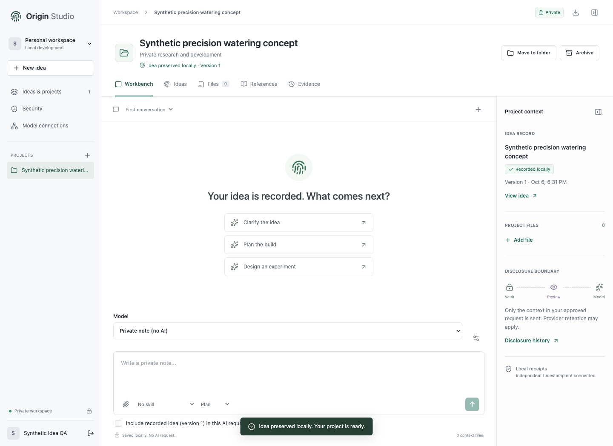

# WHOAYO

[](https://github.com/M2201/whoayo/actions/workflows/ci.yml)

WHOAYO is an idea-provenance and privacy-controlled AI workspace by Mandle
Rousseau, previously developed under the Origin Studio name.

> Record your idea before disclosure. Build through privacy-controlled AI. Preserve evidence of what you created, what was shared, and what the AI contributed.

This is an implemented local foundation, not a hosted product or feature-complete replacement for ChatGPT, Claude, or a coding IDE.

## Why WHOAYO

Most AI workspaces begin after a prompt is sent. WHOAYO begins before disclosure:

1. record the exact human starting point and declared contribution;
2. preserve and verify the selected timestamp evidence;
3. inspect and approve the exact provider request;
4. retain the response, model attribution, token usage and contribution chain;
5. export evidence that can be checked offline.

That makes WHOAYO an evidence and control layer around AI, not a claim that a hash establishes ownership, originality, patentability or legal priority.

The community source is licensed **AGPL-3.0-only** for local/self-hosted adoption at [M2201/whoayo](https://github.com/M2201/whoayo). Contributions are issues-only initially. See [license](LICENSE), [public release](docs/PUBLIC-RELEASE.md), [roadmap](docs/ROADMAP.md), [security policy](SECURITY.md) and [contributing](CONTRIBUTING.md). The WHOAYO name and logo are not a grant of trademark rights.



*Synthetic local workspace preview. No customer content or live service is shown.*

## Run

Requires Node 24.13+ with `node:sqlite` (currently experimental).

```sh
git clone https://github.com/M2201/whoayo.git
cd whoayo
npm ci
npm test
npm run build
npm start
```

For a no-provider walkthrough, choose **Explore sample** after creating a local
account. It uses synthetic data and makes no paid AI request. For development,
enable the reviewed local hooks with `git config core.hooksPath .githooks`.

Open http://127.0.0.1:4360. Create a local account, then **Record an idea**. **Preserve & start project** atomically saves the exact idea, its declared contribution, a local receipt and an immutable encrypted snapshot, and opens the new project. Cancelling leaves nothing saved. Existing projects remain intact. **Explore sample** is a separate, explicit option using synthetic, AI-assisted content; it has no real study results or external model responses.

Sign in with the email address or username used at registration. Both are case-insensitive login identifiers; an email-shaped identifier is **not a verified mailbox**. Existing usernames still work. Passwords are 12-256 characters at registration and are not trimmed or subject to extra composition rules. Save the password in a password manager: **Forgot password?** currently opens honest recovery guidance, not an email reset service. Verified recovery must be implemented before hosted customer onboarding; creating another account does not recover the original workspace.

The server binds only to 127.0.0.1 and rejects other Host/Origin values. Do not expose it through a reverse proxy or tunnel as a substitute for the hosted security architecture. `PORT` selects another free local port.

## Working Features

- Local registration and sign-in; salted scrypt password hashes; expiring HttpOnly/SameSite sessions; CSRF checks; rate limiting; account-scoped project access.
- Default-off invited OIDC sign-in routes with PKCE, signed-token verification, pre-authentication CSRF, Secure hosted cookies, provider logout and encrypted `(issuer, subject)` account mapping. A verified email never links or replaces a local account. This path is synthetic-tested but not provisioned or live.
- Private projects, project search, archive/restore, separate conversations, and private notes without model calls.
- Idea-first project creation and account-scoped folder labels for later organization. Moving a project does not rewrite its idea receipts or earlier snapshots. Folders are encrypted metadata, not filesystem paths or shared access groups.
- Eight versioned built-in prompt skills: Clarify the idea, Plan the build, Design an experiment, Customer discovery, Validate the idea, Business model, Financial scenarios, and Execution planner. Selecting a skill makes no model call and does not overwrite the draft. Instructions are visible and included in exact-request approval. These are not executable plugins, imported third-party skills, shell agents or model-quality guarantees.
- Project-scoped business-development records: a business profile, classified assumptions/experiments/metrics/decisions/actions/milestones, and deterministic financial scenarios. Records retain version history, declared human/AI contribution and preservation receipts; business context enters a model request only when explicitly selected.
- Idea records with declared human/AI assistance, linked immutable versions, random commitments, and local content receipts.
- Exact-version timestamp setup in Workbench and Evidence: fingerprint review, explicit submission approval, signed-receipt verification and private package download. External AI prepare/send require a currently verifiable receipt for the latest idea, even when its text is not included in the request. Live authority activation and Bitcoin verification are still outstanding; see [Timestamp configuration and limits](docs/TIMESTAMPS.md).
- Source/text file import, an editor, Markdown preview, file downloads, append-only versions, and saved AI drafts linked to their source message.
- Reference library with source URLs and notes. References are user-supplied and not automatically verified or fetched.
- OpenAI Responses, Anthropic Messages, Gemini and Kimi text-chat adapters with server-approved model lists. Exact request review includes system instructions, selected files, optional conversation history, provider, chosen model, endpoint and request digest. Configured does not mean live-verified.
- Approval is one-use, revision-bound, expires after ten minutes, and is consumed before the outbound request. A local receipt and disclosure attempt are saved before provider access.
- Known credential patterns are blocked before disclosure. No default vault retrieval, shell execution, external tools, publication, or deployment by agents.
- The latest idea is included in an AI request only when explicitly selected. Its exact source is credential-scanned; the reviewed skill/version and idea commitment remain attached to the disclosure. The original record is never rewritten by model output. Skills do not execute when saving a private note.
- Bounded concurrency, 45-second provider deadline, output size limits, a persistent per-account daily attempt cap, no automatic retries, and explicit uncertain outcomes after errors or restart.
- Optional fixed-point monetary controls that reserve a conservative maximum before provider access, atomically enforce account/platform monthly limits, reconcile valid token usage to an estimate, and retain ambiguous costs. Managed hosted AI fails closed without this guard. These estimates do not replace provider invoices.
- Default-off Stripe test Checkout/portal, signed raw-body webhook verification, persistent deduplication, current-subscription reconciliation and account-bound entitlements. Managed hosted AI also requires active plan access at prepare and send. Test billing has an account view under Security. Live payments are rejected pending the remaining acceptance work in [Payments](docs/PAYMENTS.md).
- Evidence timeline, request/response contribution attribution, locally verified exports, and an offline content-receipt verifier.
- Background rule-based monitoring of project integrity, known credential patterns, and unresolved disclosures every 60 seconds while the server runs.
- Responsive desktop/mobile interface, keyboard-focus states, native modal focus containment, and no remote fonts, analytics, or embedded external images.
- The welcome page and workspace home identify WHOAYO's preserved origin concept, recorded under the former Origin Studio name, revision 2, as linked to the completed Bitcoin proof with an earliest attested time of October 5, 2026 at 04:52:27 UTC. Package/fingerprint/proof linkage was checked read-only on October 9; the prior public-explorer cross-check was October 7. The later WHOAYO name is not itself covered by that timestamp. No local Bitcoin-node verification, NFT, ownership claim or coverage for later work is implied. The public page uses reviewed metadata only, not private vault requests.
- Signed-out visitors now see a full public-facing introduction with prominent concept-evidence status, timestamp explanation, interactive researcher/no-code/low-code examples, a real synthetic workspace preview, FAQ, and the existing local account form. Signed-in users can inspect the same page at `/?view=welcome` and return without signing out. This is a local website preview, not open public enrollment. See [Website presentation](docs/PUBLIC-WEBSITE.md).

## Storage And Recovery

Hosted operation is the active next workstream. [Hosted launch](docs/HOSTED-LAUNCH.md) records the requested enrollment/usage-plan business model, agents, publishing and customer-authorized storage copies, their actual implementation status, and the remaining release gates. The Cognito OIDC adapter is now connected to default-off HTTP routes and an encrypted app-account mapping, with synthetic callback, two-session, timestamp, model, artifact and export coverage. Cognito, TLS ingress, DNS, email and customer invitations remain unprovisioned and untested live. Local accounts remain separate and available in local mode.

The default `.local-data` directory is private to the local operating-system user. It contains a SQLite database and a separately stored local master key. Project titles, content, reference notes, chat messages, pending requests, disclosure payloads, and event payloads are encrypted with AES-256-GCM. Each project has a unique key wrapped by the master key. Additional authenticated data binds ciphertext to its owner/project/event context.

Usernames, password verifiers, session hashes, opaque identifiers, usage counters, and some event metadata are not encrypted. The complete device is not protected by this application. A machine administrator or a compromised server process can access decryption keys and plaintext; this is server-managed encryption, not zero-knowledge storage. Production requires an independent key-management service and operational separation.

The offline recovery CLI creates a consistent encrypted SQLite archive with the matching master key, protected by a separate recovery key. Restore only to a new directory; restored sessions, pending AI approvals and billing access authority are invalidated without rewriting earlier evidence. Read [Security and recovery](docs/SECURITY-RECOVERY.md) before use. Each operator must establish separate off-device key custody, scheduled backups, retention, sign-in after disaster recovery, account recovery and key rotation. Private operational recovery records are not included in this source release.

The application has its own Git repository with reviewed source allowlisting, a staged-secret check, CI/community files and an approved-destination push check. Public publication at `M2201/whoayo` under AGPL-3.0-only was approved October 14, 2026. See [Public release](docs/PUBLIC-RELEASE.md) for the current release boundary.

**Security -> Sessions -> Sign out everywhere** ends every current session for your account after password confirmation. It does not affect other accounts, reset a compromised password, recall provider requests, or remove previously downloaded exports.

## Model Configuration

The workbench now has a model chooser and a draft-preserving connections dialog. See [Multi-model workspace](docs/MODEL-ACCESS.md) for plural model allowlists, Gemini/Kimi configuration, policy-review gates, disable controls and live-acceptance requirements. The table below retains the original single-model configuration for compatibility. No new real provider credentials were added by the multi-model implementation.

Use a dedicated server environment. Never reuse another project's credentials implicitly. `.env.example` lists names only. The server does not automatically load `.env`; use a secret manager, inherited process environment, or Node's `--env-file` option for a private, uncommitted file.

| Name                                    | Effect                                                   |
| --------------------------------------- | -------------------------------------------------------- |
| `ORIGIN_EXTERNAL_AI`                    | `1` enables configured adapters; default off             |
| `ORIGIN_OPENAI_KEY`                     | Server-only OpenAI API credential                        |
| `ORIGIN_OPENAI_MODEL`                   | Explicit model ID available to that account              |
| `ORIGIN_ANTHROPIC_KEY`                  | Server-only Anthropic API credential                     |
| `ORIGIN_ANTHROPIC_MODEL`                | Explicit model ID available to that account              |
| `ORIGIN_DAILY_REQUEST_LIMIT`            | Attempt cap per account per UTC day, default 20          |
| `ORIGIN_SPEND_GUARD`                    | `1` enables pre-call monetary reservations               |
| `ORIGIN_ACCOUNT_MONTHLY_AI_BUDGET_USD`  | Per-account monthly reserved/estimated ceiling           |
| `ORIGIN_PLATFORM_MONTHLY_AI_BUDGET_USD` | Application-wide monthly reserved/estimated ceiling      |
| `ORIGIN_MODEL_PRICES_JSON`              | Versioned exact-model price catalog                      |
| `ORIGIN_MASTER_KEY`                     | Optional 32-byte master key encoded as 64 hex characters |
| `ORIGIN_DATA_DIR`                       | Private local data directory                             |
| `PORT`                                  | Loopback port, default 4360                              |

Restart after changing configuration. Do not replace a master key for an existing database without a migration. The attempt cap is not a dollar budget. Configure provider billing limits before live use. OpenAI requests use `store:false`; this alone does not mean zero retention. Anthropic requests do not enable prompt caching, but provider retention can still apply. Provider-specific contracts, account settings, and legal/security exceptions require separate review. No adapter can prove a provider's internal compliance with its terms.

For local OpenAI setup, `npm run connect:openai` opens a one-time loopback form. Paste a dedicated key there, never into chat. It writes a new `.env.local` with owner-only permissions, refuses to overwrite an existing file, and closes after one save or 15 minutes. It does not call a provider. Start the configured app with `npm run start:connected`. Plain `npm start` still uses only inherited environment variables.

`npm run test:live` requires `.env.local` and makes at most two synthetic requests to `gpt-6-astra`. It reserves conservative estimated charges below a $1 total ceiling, never retries, and refuses to run again if its `output/live-openai/run.json` ledger exists. Review an interrupted run rather than deleting its ledger to retry blindly. It is not an application-wide monetary budget. Results and synthetic evidence are written to `output/live-openai/`; costs are estimates, not provider invoices.

Disable all model traffic with `ORIGIN_EXTERNAL_AI=0` and restart. Removing an individual provider credential also disables that adapter. A failed request may have been received or billed; use its recorded digest and timestamp when reconciling. The application never silently retries.

Read [Monetary controls](docs/MONETARY-CONTROLS.md) before live use. Run `npm run check:business` to inspect the proposed—not live—revenue and gross-margin model in `operations/unit-economics.json`. The commercial target and launch assumptions are documented in [Commercial plan](docs/COMMERCIAL-PLAN.md).

## Evidence Verification

In Evidence, export the project package. This contains private plaintext, including approved requests; handle it as a sensitive export.

```sh
node scripts/verify-package.mjs /path/to/origin-project.json
```

The offline verifier checks content fingerprints, nonce-based commitments, version lineage, and disclosure-request digests. New preserved packages additionally bind the complete exported project, metadata, and events to a salted commitment. This checks consistency against the retained commitment, not the historical truth of those fields. It does not independently establish contributor identity, blockchain anchoring, time, ownership, or the provider's receipt of a request. Local event chains detect changes relative to retained state, but an administrator able to replace the entire database and its key can rewrite unanchored history. Keep witnessed exports outside this operator's control. No blockchain or trusted timestamp is submitted by this version.

### Description Review And Evidence Limits

The idea-recording dialog and Evidence view distinguish proof of an exact package's existence from evaluation of the underlying idea. Public minting of an abstract is not required for the fingerprint linkage; retain the private package and proof. A timestamp does not establish originality, ownership, patentability, or legal defensibility.

**Check description** is a local, rule-based checklist, not an LLM or legal score. It flags prompts for the problem/users, mechanism, differences, examples, supporting work/unknowns, and attribution/disclosures. Keyword matches are explicitly labeled as mentions needing human review. Review does not save or modify the draft, rewrite earlier evidence, perform prior-art searches, contact an external provider, or submit a timestamp. Edits clear the displayed review. The optional JSON download binds the review to a SHA-256 of the exact title and description; this is not itself a signed or timestamped evidence record.

An optional **Review with local model** adapter uses Ollama's documented `/api/tags` and `/api/chat` APIs at the fixed address `http://127.0.0.1:11434`. It is off by default and never falls back to OpenAI, Anthropic, or another cloud provider. No runtime or model is downloaded automatically. No local LLM has been installed or evaluated for this feature yet.

Before enabling, install and evaluate an appropriate local model, run the Ollama service with `OLLAMA_NO_CLOUD=1`, restart it, and verify its log reports cloud disabled. Review the runtime's configuration and egress independently; an application flag cannot prove that a compromised local service is private. Then configure these server-side values and restart WHOAYO:

- `ORIGIN_LOCAL_REVIEW=1`
- `ORIGIN_LOCAL_REVIEW_MODEL`: exact installed name and tag, no cloud model.
- `ORIGIN_LOCAL_REVIEW_DIGEST`: exact 64-character installed weights digest from `/api/tags`.
- `ORIGIN_LOCAL_REVIEW_OFFLINE_CONFIRMED=1`: operator acknowledgment of the runtime check above, not an automatic attestation.

The adapter checks the installed GGUF model and pinned digest before transmitting a description, refuses redirects and remote model metadata, requires per-draft consent, limits concurrent requests to one, times out after 30 seconds, bounds input/output sizes, and rejects malformed responses or fabricated excerpts. Model suggestions can only identify completeness categories and exact excerpts; no invented legal verdict, tool call, or automatic rewrite is accepted. Authenticated owner and CSRF checks apply; review leaves project evidence unchanged. Set `ORIGIN_LOCAL_REVIEW=0` and restart to disable. Live local-model quality, context capacity, performance, and egress verification remain required before enablement.

References: [Ollama chat API](https://docs.ollama.com/api/chat), [structured outputs](https://docs.ollama.com/capabilities/structured-outputs), and [cloud-disable configuration](https://docs.ollama.com/faq#how-do-i-disable-ollama-cloud-features).

### Preserved Packages

Saving an idea, artifact, private note, reference, or an AI disclosure attempt/completion/failure now creates an encrypted immutable package in the same SQLite transaction. If preservation fails, the local save rolls back rather than falsely reporting preservation. Packages are unique per project revision, link to the previous package, and exclude pending model-approval tokens. Existing projects can use **Preserve current revision** without changing their original text, receipts, or event history. **Export package** also preserves the current revision and downloads that stable package.

The **Preserved packages** list provides exact-version private downloads and **Prepare timestamp**. Preparation is entirely local: the `.txt` file contains only a protocol label and a salted 32-byte commitment. The nonce and private concept remain inside the private JSON package. Keep those files together. `npm run verify -- /path/to/package.json` accepts both the earlier `origin-export/1` format and the new `origin-preservation/1` format.

The external service is [OpenTimestamps](https://opentimestamps.org/), whose public calendars are documented as free with no API key or wallet required. The app does not automatically contact calendars. External submission uses the official CLI and needs explicit approval of the exact fingerprint, service, network, and cost. Only the fingerprint file, never the private JSON, belongs in that handoff. A returned pending receipt is not a verified Bitcoin timestamp.

After an approved submission, the local operator can import its pending receipt using `node scripts/import-timestamp.mjs SNAPSHOT_ID PROOF_PATH RESULT_PATH`. This command requires the official OpenTimestamps Python library in `output/tooling/ots-venv`, parses the detached proof, checks its digest against the exact preserved package and submission result, and stores an encrypted immutable receipt without changing the original snapshot. There is no HTTP import endpoint.

After an explicitly approved proof upgrade and Bitcoin cross-check, `node scripts/import-timestamp-completion.mjs SNAPSHOT_ID COMPLETED_PROOF_PATH RESULT_PATH` can append a separate encrypted completion record. It never overwrites the original pending receipt. The authenticated evidence view can then show the public fingerprint, attested block times/heights and user-opened explorer links, while keeping the concept, nonce, private package, account identity and internal paths out of the display. A public-explorer cross-check is labeled as such and is not represented as local Bitcoin-node verification. Proof retrieval/verification is not scheduled or automatic, and a completed timestamp does not establish originality, ownership, identity or legal rights.

These snapshots are in the same encrypted database on the same Mac, not an independent backup. Losing the database and master key can lose the project. Separate-device backup and recovery remain required before a hosted launch. Browser QA should use a separate browser profile/session: changing a localhost port alone does not isolate cookies.

## Sources

- Earlier private concept packages and ledger records remain preserved outside this source release.
- [OpenAI Responses](https://developers.openai.com/api/reference/resources/responses/methods/create)
- [OpenAI data controls](https://developers.openai.com/api/docs/guides/your-data)
- [Anthropic Messages](https://platform.claude.com/docs/en/api/messages/create)
- [Node cryptography](https://nodejs.org/api/crypto.html)
- [NIST secure software development](https://csrc.nist.gov/pubs/sp/800/218/final)

See `docs/PRODUCT.md`, `docs/THREAT-MODEL.md`, and `docs/RELEASE-STATUS.md` for the broader product requirements and implementation boundaries.
